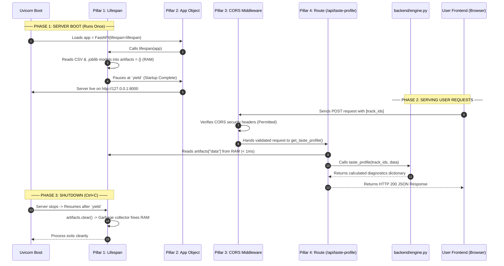

# FastAPI Architecture Blueprint & Production Cheat Sheet
### *The Universal 4-Pillar Mental Model for Building Production ML APIs*

A practical, step-by-step reference designed to guide you through architecting and writing `main.py` for any full-stack or machine learning project from scratch.

---

## 1. The Big Picture: The 3-File Architecture

Before writing a single line of backend code, divide your backend into three clear responsibilities:

```
backend/
├── schemas.py   ──► 1. THE DATA CONTRACTS (Pydantic BaseModel)
│                    - Validates incoming request shapes.
│                    - Guarantees outgoing response shapes.
│
├── engine.py    ──► 2. THE PURE ML / BUSINESS LOGIC (Zero Web Code)
│                    - Pure Python, Pandas, NumPy, Scikit-Learn.
│                    - Accepts clean inputs, returns native Python dicts.
│
└── main.py      ──► 3. THE API GATEWAY (FastAPI + Uvicorn)
                     - The front door. Houses the 4 essential pillars below.
```

---

## 2. The Universal Template: The 4 Pillars of `main.py`

Every production `main.py` is composed of these exact 4 sequential pillars:

```python
# ==============================================================================
# IMPORTS & DATA CONTRACTS
# ==============================================================================
import os
import json
import joblib
import pandas as pd
from contextlib import asynccontextmanager
from fastapi import FastAPI, HTTPException, Query
from fastapi.middleware.cors import CORSMiddleware

# Import contracts & pure business logic
from backend.schemas import TrackSearchResult, TasteProfileRequest, TasteProfileResponse
from backend.engine import taste_profile


# ==============================================================================
# PILLAR 1: IN-MEMORY ARTIFACT STORE & LIFESPAN LOADER (Preparation)
# ==============================================================================
# Global warehouse: Accessible by all route functions
# Dictionaries give O(1) instant memory lookups across the entire server
artifacts = {}

@asynccontextmanager
async def lifespan(app: FastAPI):
    """
    Lifespan Context Manager: Controls the server's lifecycle.
      - Code BEFORE `yield`: Executes ONCE at server boot (Startup).
      - The `yield`: The server pauses here and answers user requests.
      - Code AFTER `yield`: Executes ONCE when server shuts down (Teardown).
    """
    # 1. Construct OS-independent full path to project root
    base_dir = os.path.dirname(os.path.dirname(os.path.abspath(__file__))) # Root folder
    data_path = os.path.join(base_dir, "data", "spotify_tracks_modeled.csv")
    models_dir = os.path.join(base_dir, "models")

    # 2. Defensive existence check: Fail fast if training artifacts are missing
    if not os.path.exists(data_path):
        raise FileNotFoundError(f"Modeled data not found at {data_path}. Run training first.")
    
    # 3. Read disk ONCE into RAM: Routes access this instantly (< 4ms)
    artifacts["data"] = pd.read_csv(data_path)

    # 4. Load trained Scikit-Learn models and metadata into RAM
    artifacts["kmeans"] = joblib.load(os.path.join(models_dir, "kmeans_model.joblib"))
    artifacts["power_transformer"] = joblib.load(os.path.join(models_dir, "power_transformer.joblib"))
    artifacts["pca_2d"] = joblib.load(os.path.join(models_dir, "pca_2d.joblib"))

    # ─── 5. THE SERVING PAUSE ─────────────────────────────────────────────────
    yield  # The server stays awake here, processing incoming user requests!

    # ─── 6. SHUTDOWN CLEANUP ──────────────────────────────────────────────────
    print("🛑 [Shutdown] Cleaning up in-memory resources...")
    artifacts.clear()  # Drop references -> Garbage Collector frees RAM immediately


# ==============================================================================
# PILLAR 2: APPLICATION INSTANTIATION (The Central Coordinator)
# ==============================================================================
# Creates the central `app` object that manages routes, settings, and docs.
# The `lifespan=lifespan` argument binds our Pillar 1 startup logic to this app.
app = FastAPI(
    title="Spotify Taste Profile Engine API",
    description="Production ML API that clusters songs into 7 Sound Personas and computes listener diagnostics.",
    version="1.0.0",
    lifespan=lifespan,  # Binds Pillar 1 lifecycle to this app instance
)


# ==============================================================================
# PILLAR 3: CORS SECURITY MIDDLEWARE (Browser Access Handshake)
# ==============================================================================
# Web browsers enforce the 'Same-Origin Policy': they block frontends (e.g.
# localhost:3000 or vercel.app) from fetching data from backends on another port
# (e.g. localhost:8000 or render.com) unless the API explicitly sends permission.
app.add_middleware(
    CORSMiddleware,            # Intercepts every request to handle browser Cross-Origin security checks
    allow_origins=["*"],       # Whitelist of allowed frontend domains ("*" allows all; in prod use ["https://your-site.vercel.app"])
    allow_credentials=True,    # Allows frontend to pass cookies, authorization headers, or session tokens across origins
    allow_methods=["*"],       # Allowed HTTP actions ("*" permits GET, POST, OPTIONS, PUT, DELETE, etc.)
    allow_headers=["*"],       # Allowed HTTP headers sent by browser ("*" permits Content-Type, Authorization, etc.)
)


# ==============================================================================
# PILLAR 4: THE ROUTES & ENDPOINTS (The Doors to the Outside World)
# ==============================================================================
# Golden Rule: Keep routes thin. Route functions should only:
#   1. Read pre-loaded data from `artifacts`.
#   2. Validate inputs.
#   3. Delegate heavy math to `engine.py`.
#   4. Return the result.

# Route 0: Health Check (Required for cloud hosts like Render/AWS to verify uptime)
@app.get("/api/health", tags=["System"])
def health_check():
    return {
        "status": "healthy",
        "loaded_tracks": len(artifacts.get("data", [])),
        "models_ready": "kmeans" in artifacts,
    }

# Route 1: Song Search (GET: URL query parameters ?q=queen&limit=10)
@app.get("/api/search", response_model=list[TrackSearchResult], tags=["Search"])
def search_tracks(
    q: str = Query(..., min_length=1, description="Search keyword for track name or artist"),
    limit: int = Query(10, ge=1, le=50, description="Max results to return"),
):
    data = artifacts["data"]
    keyword = q.strip().lower()
    
    # Fast vectorized search in RAM (boolean masking)
    mask = (
        data["track_name"].str.lower().str.contains(keyword, na=False)
        | data["artists"].str.lower().str.contains(keyword, na=False)
    )
    matches = data[mask].sort_values(by="popularity", ascending=False).head(limit)
    return matches[["track_id", "track_name", "artists", "album_name", "track_genre", "persona"]].to_dict(orient="records")

# Route 2: Taste Profile ML Inference (POST: structured JSON body payload)
@app.post("/api/taste-profile", response_model=TasteProfileResponse, tags=["ML Inference"])
def get_taste_profile(request: TasteProfileRequest):
    data = artifacts["data"]
    
    # Defensive check: ensure requested songs exist in our modeled dataset
    selected = data[data["track_id"].isin(request.track_ids)]
    if selected.empty:
        raise HTTPException(
            status_code=404,
            detail="None of the provided track IDs were found in the dataset.",
        )
    
    # Delegate pure mathematical computation to engine.py
    return taste_profile(request.track_ids, data)
```

---

## 3. Detailed Breakdown: How Each Pillar Works Under the Hood

### Pillar 1: In-Memory Artifact Store & Lifespan Loader (Preparation)
> **Role:** The Chef's Prep Cook. Reads heavy files from disk once before opening the doors.

* **The Problem It Solves:** Reading a 128,000-row CSV (`pd.read_csv`) or a complex ML model (`joblib.load`) from disk takes **300ms to 2000ms**. If you do this inside a route function, every single user click suffers huge lag, and multiple concurrent users can spike memory until the server crashes.
* **How It Works:**
  1. `artifacts = {}`: Creates a top-level global dictionary. Dictionaries offer **$O(1)$ constant-time lookup** in RAM.
  2. `base_dir = os.path.dirname(os.path.dirname(os.path.abspath(__file__)))`:
     * `abspath(__file__)` finds `backend/main.py` anywhere on disk.
     * First `dirname()` moves up to `backend/`.
     * Second `dirname()` moves up to project root.
     * `os.path.join()` connects subfolders with OS-safe slashes (`\` on Windows, `/` on Linux/Render).
  3. `if not os.path.exists(...)`: **"Fail Fast" design.** If the ML model or modeled CSV is missing, crash immediately at server boot with a clear error rather than failing silently and breaking when a live user searches.
  4. `artifacts["key"] = ...`: Reads the files into memory **once**.
  5. `yield`: Python's generator pause keyword. It halts the `lifespan` function right here while the server is alive and answers requests.
  6. `artifacts.clear()`: Executes **only on shutdown** (e.g. `Ctrl+C` or Render stopping the container). Drops all dictionary references so Python's Garbage Collector instantly frees the RAM.

---

### Pillar 2: Application Instantiation (The Central Coordinator)
> **Role:** The Master Brain. Creates the single central object that unites routes, settings, and life cycles.

* **The Problem It Solves:** A web server needs a single coordinator that knows which URLs exist, what documentation to generate, and when to run startup logic.
* **How It Works:**
  1. `app = FastAPI(...)`: Instantiates the master application object.
  2. `title`, `description`, `version`: Automatically builds an interactive documentation website at `http://127.0.0.1:8000/docs` (Swagger UI).
  3. `lifespan=lifespan`: **The Critical Connection.** This argument tells FastAPI: *"Do not open port 8000 until you have run the startup code in Pillar 1; and run its cleanup code when you stop."*

---

### Pillar 3: CORS Security Middleware (The Security Bouncer)
> **Role:** The Passport Control / Browser Handshake.

* **The Problem It Solves:** Web browsers enforce the **Same-Origin Policy (SOP)**. A browser on `http://localhost:3000` (or `my-app.vercel.app`) is forbidden from fetching data from `http://localhost:8000` (or `my-api.onrender.com`) unless the backend explicitly attaches permission headers. Without Pillar 3, your API works in Swagger `/docs`, but your frontend browser console will throw red CORS errors!
* **How It Works:**
  1. **The Preflight Handshake:** Before sending a `POST` request, the browser sends a quiet HTTP `OPTIONS` request asking: *"Hey backend, are you willing to accept requests from my domain?"*
  2. `app.add_middleware(CORSMiddleware, ...)`: Intercepts every incoming request and attaches HTTP response headers:
     * `Access-Control-Allow-Origin: *` (Allows any origin to talk to our API).
     * `Access-Control-Allow-Methods: *` (Allows GET, POST, OPTIONS, etc.).
     * `Access-Control-Allow-Headers: *` (Allows JSON headers like Content-Type).

---

### Pillar 4: The Routes & Endpoints (The Public Doors)
> **Role:** The Thin Traffic Cops. Handles outside HTTP traffic.

* **The Golden Rule: Keep Routes Thin.** A route function should never contain 100 lines of data science or feature engineering. It has only 4 duties:
  1. **Receive & Validate Input:** Uses Pydantic schemas or `Query()` to reject invalid shapes before any code runs.
  2. **Fetch In-Memory Data:** Grabs `data = artifacts["data"]` directly from RAM in microseconds.
  3. **Delegate the Heavy Work:** Calls `taste_profile(track_ids, data)` from `backend/engine.py`.
  4. **Return Clean Data:** Returns native Python dictionaries or lists conforming to the response schema.

---

## 4. How the 4 Pillars Work Together: The Complete Lifecycle

Here is how all 4 pillars collaborate from the second you start your server to the moment a user clicks a button:



---

## 5. Decision Matrix: `GET` vs `POST`

| Question | Use `GET` | Use `POST` |
| :--- | :--- | :--- |
| **What is the client doing?** | Reading / searching / fetching data | Submitting data / running complex computation |
| **Where does data travel?** | Directly in the URL (`?q=queen&page=2`) | Inside a hidden JSON body payload |
| **Does it need a Request Schema?** | **No** (use `Query()` inside function args) | **Yes** (use Pydantic `BaseModel` class) |
| **Example in our project** | `GET /api/search?q=queen` | `POST /api/taste-profile` |

---

## 6. Step-by-Step Mid-Project Building Checklist

When adding a new feature or endpoint mid-project, follow this exact 5-step loop:

1. **Write the Schema first (`schemas.py`)**:
   * What exact JSON does the frontend send? Create `XRequest(BaseModel)`.
   * What exact JSON does the frontend need back? Create `XResponse(BaseModel)`.

2. **Write the Math / Business Logic (`engine.py`)**:
   * Create a pure Python function: `def compute_x(inputs, data, model): ...`
   * Test it locally with sample data. Ensure it returns a standard Python `dict`.

3. **Wire it into `main.py`**:
   * Add the route decorator: `@app.post("/api/x", response_model=XResponse)`.
   * Pull pre-loaded data/models from `artifacts`.
   * Add edge-case validation (`raise HTTPException(status_code=404, detail=...)`).
   * Return the result of calling your `engine.py` function.

4. **Boot the Server**:
   ```bash
   uvicorn backend.main:app --reload
   ```
   * `backend.main`: Looks for file `backend/main.py`.
   * `:app`: Looks for the variable `app = FastAPI(...)`.
   * `--reload`: Auto-restarts the server whenever you edit code.

5. **Test in Swagger UI**:
   * Open `http://127.0.0.1:8000/docs` in your browser.
   * Click your endpoint $\rightarrow$ **Try it out** $\rightarrow$ **Execute**.
   * Verify the response status is `200 OK`.

---

## 7. Five Critical Traps to Avoid

| The Trap | What Goes Wrong | The Professional Solution |
| :--- | :--- | :--- |
| **1. The Disk I/O Trap** | Putting `pd.read_csv()` or `joblib.load()` inside a route function. Every request lags by 300ms+. | Put all loading inside `lifespan` before `yield` so it loads into RAM **once**. |
| **2. The CORS Trap** | Forgetting `CORSMiddleware`. The API works in Swagger, but the frontend console throws red errors. | Always include `app.add_middleware(CORSMiddleware, ...)` in `main.py`. |
| **3. The Silent Crash Trap** | Letting Python raise an unhandled `KeyError` or `IndexError` on bad inputs (crashes with HTTP 500). | Catch edge cases and explicitly `raise HTTPException(status_code=404, detail="...")`. |
| **4. The Monolith Trap** | Writing 200 lines of data cleaning, loops, and math inside `main.py`. | Keep `main.py` thin. Move all math to `engine.py`. `main.py` is just a traffic cop. |
| **5. The Serialization Trap** | Returning NumPy types (`np.float64`, `np.int64`, NumPy arrays) that crash standard JSON encoders. | Use Pydantic response models, wrap numbers in standard `float()` / `int()`, or use `.to_dict(orient="records")`. |
